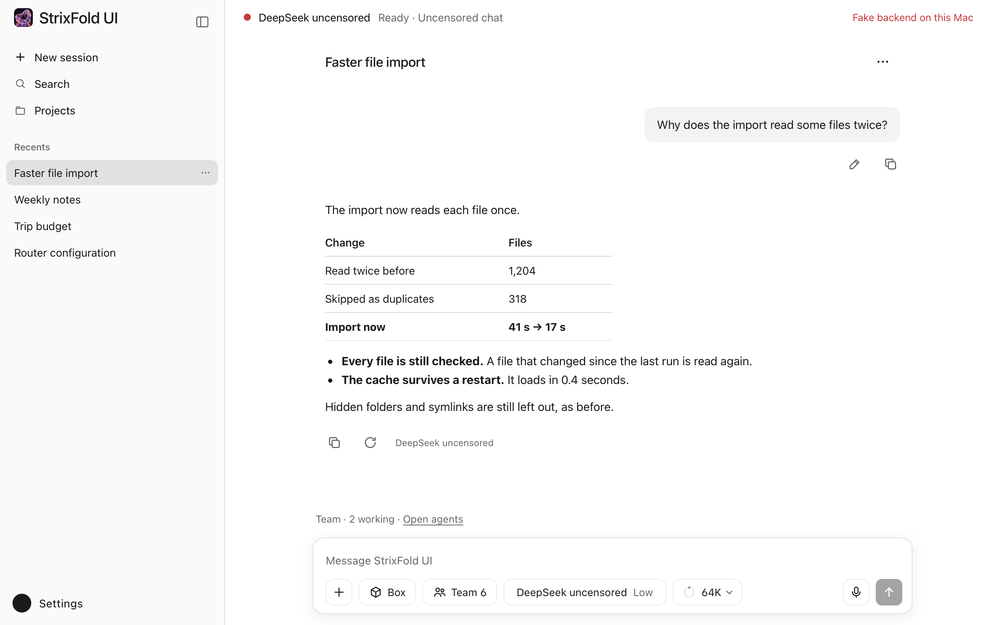
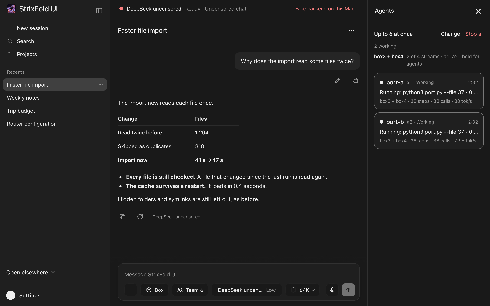
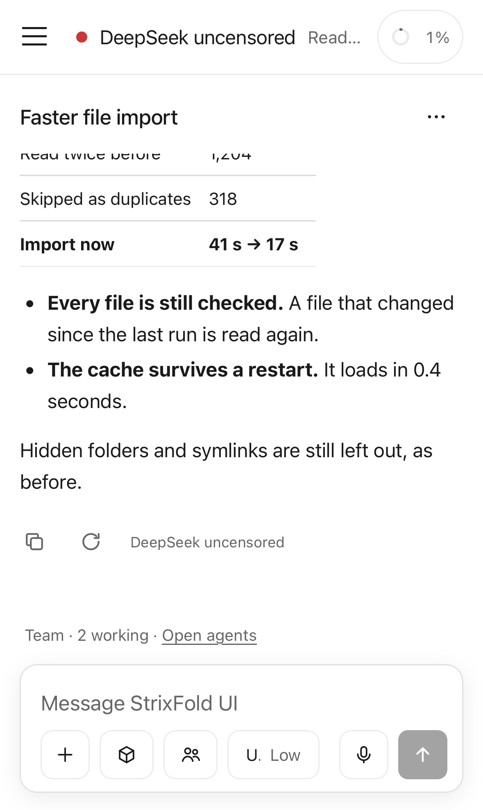

# StrixFold UI

StrixFold UI is a private chat app for your own AI hardware. It runs on a Mac and talks to the models on two AMD
Strix Halo boxes (AMD Ryzen AI Max machines, such as two Bosgame M5s), linked over USB4. Your chats, files and documents
stay on the Mac. The models stay on your boxes. Nothing leaves them unless you give a chat a tool that can: the web (its
searches go to DuckDuckGo, Brave, Startpage, Mojeek, Bing, Yahoo, Wikipedia and arXiv, and it opens pages), Full access
or Direct.



## What has been tested

- The test suite passes on a Mac (Apple silicon, the system's Python 3.9). A script (not in this repository) drives the
  page in a browser, on the fake backend: the first start, chats, goals, documents, steering, both themes and phone
  widths.
- `connect` (below) has run on one pair of Bosgame M5s with StrixFold already running: two chat turns, the tool levels,
  a goal. It hasn't been tried from the login item, on the phone, or with a key that has a passphrase.
- The app this one grew out of runs daily on the hardware below. The longer set-up, where the app starts and stops the
  models itself, has been read against the code; nobody has yet followed it from start to finish on fresh boxes. If
  something fails, please open an issue.

## What it does

- **Chats** with streaming replies, documents (read, filled in and made as PDFs), pictures (a small local vision model
  describes them), projects, and search across chats.
- **Private chats** behind a passcode. They are encrypted on the Mac's disk (other chats aren't), and their words go
  only to your own boxes, unless you give the chat Container (its files open in that machine's memory while a command
  runs) or Container + web (its searches and page reads go out).
- **Tools** you choose per chat: none; a container on another machine, with or without the web; Full access on this Mac,
  in a macOS sandbox limited to the chat's folder or to your home folder without its keys, which asks before risky
  commands (before every command on DeepSeek uncensored); or Direct (below), which never asks. The web tools go through
  an egress guard that refuses private and local addresses.
- **Team mode:** a chat's lead model can start several agents that work in parallel on your pairs of boxes, with a
  watcher that stops loops and stalls. The agents run on DeepSeek uncensored with the chat's own tools, so give such a
  chat only what you'd give that model. With one pair of boxes they run when it is idle or already serves that model.
- **Steering mid-answer:** a message you send while it works reaches the model at its next step, so the answer keeps its
  reasoning so far. Send now stops the answer and sends yours at once, in Team chats too.
- **Phone access:** a home-screen app over your tailnet, the same chats as on the Mac.
- **Goals:** `/goal <what should be true>` keeps a chat working, turn after turn, until a separate check says it is met
  or impossible. It pauses if you press Stop, if three turns in a row use no tools, if a reply goes round in circles, if
  turns keep failing or if the check can't be read; your next message takes it up. `/goal` shows how it stands and
  `/goal clear` ends it. Not in Private chats.
- **Light and dark**, following the system or set in Settings › Appearance. Drag the sidebar's edge to resize it;
  a double click puts it back.

<p>
  
  
</p>

The screenshots are staged with made-up chats, boxes and agents.

## The models

| Model | Engine | Notes |
| --- | --- | --- |
| DeepSeek V4.1 Flash (EXL3 2.9 bpw) | [StrixFold](https://github.com/Shoestring-dev/StrixFold), split across both boxes | 1M context, drafts on |
| DeepSeek V4.1 Flash, uncensored | StrixFold, the same weights with the uncensored edit (StrixFold's docs/UNCENSORED.md) | skips safety confirmations by design: give it read-only tools |
| Qwen 3.8 Flash Next | Halogen, a copy on each box; set up separately (its launcher is `~/bin/halo-qwen-halogen`) | the fastest start |

## What it needs

- A Mac with Python 3.9 or later (the system's own is enough). The app itself uses the standard library only; reading
  PDFs and scanned pages builds a small helper with Apple's command line tools (`xcode-select --install`) the first
  time.
- Optional parts, each a script that installs its own pinned environment once: web search and page reading
  (`tools/setup_agents_tools.sh`; needs [uv](https://docs.astral.sh/uv/) and Python 3.12.13), the photo look, a small
  local vision model that lets the text-only models read photos (`tools/setup_look.sh`), and the reader for old Excel
  files (`tools/setup_office_reader.sh`). Dictation is in the app but has no set-up script yet.
- Two Strix Halo boxes with 128 GB each, Linux, linked by USB4, with StrixFold built and its inputs prepared
  ([StrixFold's README](https://github.com/Shoestring-dev/StrixFold)).
- SSH from the Mac to the box that serves. (The longer set-up: to both boxes by name, `Host` entries in `~/.ssh/config`,
  `box1` and `box2` by default, and from `box2` to `box1`.)
- Optional: Tailscale for the phone app (`tailscale serve --bg 8713` on the Mac, never Funnel: the app answers there,
  with its passcode), a machine for containerized tools.

## Try it without GPUs

The fake backend runs everything on the Mac with stand-in models, so you can see the app before setting up the boxes:

```
git clone https://github.com/Shoestring-dev/StrixFold-UI && cd StrixFold-UI
bin/halo-control --fake
```

It opens http://127.0.0.1:8711/ on the chat. Before the first chat it asks you to choose the app's passcode. The fake
backend keeps its chats in `~/Pictures/StrixFoldUI-test`; the real app keeps them in `~/Pictures/StrixFoldUI` (Full
access never reads Pictures; the app's folder there is kept out of Time Machine, so back it up yourself), and its
settings in `~/.config/halo-control`.

## Connect it to StrixFold

With [StrixFold](https://github.com/Shoestring-dev/StrixFold) running on your boxes (its `first_light.sh up`), this is
all the app needs, on the Mac:

```
bin/halo-control connect HOST
```

`HOST` is the box that serves (node0), as ssh knows it: a name from `~/.ssh/config`, or `user@address`. It checks that
ssh gets there by itself and that a StrixFold server answers on that box's 127.0.0.1:18080 (`HOST:PORT` for another
port), and says what to do if not. Then it opens the app on it, over one SSH tunnel. Nothing is installed, started or
stopped on the boxes. `bin/halo-control disconnect` forgets it.

Connected like this, chats, projects, documents, goals and the tools work, with the model and the window the server has.
Not there: starting or switching models, Team, Private chats and the boxes' readings. Those need the longer set-up.

StrixFold starts with a window of 8,192 tokens (`CONTEXT` in its `serve.conf`), which is short for chats; the app shows
the window beside the model. For a longer one, set `CONTEXT=63488` in your `my.conf` on both boxes and start StrixFold
again (its BUILD_AND_RUN, [Settings that
matter](https://github.com/Shoestring-dev/StrixFold/blob/main/tools/dsv41-hip/BUILD_AND_RUN.md), says what that needs).

## Advanced: let the app run the models

Here the app starts, stops and switches the models on the boxes itself.

1. On each box, copy `box/` to `~/halo-control/box/`. The boxes' hostnames are `box1` and `box2`, and `box2` reaches
   `box1` over ssh by that name. On `box2`, install and start `halod` (a user service):

   ```
   mkdir -p ~/.config/systemd/user && cp ~/halo-control/box/halod.service ~/.config/systemd/user/
   systemctl --user enable --now halod.service && sudo loginctl enable-linger "$USER"
   ```
2. On each box, set your USB4 link's addresses in `box/inference_net/firewall.sh` (10.40.0.1 and .2, 10.40.1.1 and .2 as
   it ships), then install the network boundary DeepSeek's ranks run in, from the account that runs the model (it must
   be in the group `sudo`): `sudo bash ~/halo-control/box/inference_net/install.sh`. Every DeepSeek profile starts its
   ranks through it; [box/inference_net/README.md](box/inference_net/README.md) says what it allows.
3. Deploy StrixFold to `~/tfp/deploy/<commit>` on both boxes and point `box/profiles.py`'s models at it.
4. On the Mac, run `bin/halo-control` (after `bin/halo-control disconnect`, if you had connected it). It opens SSH
   tunnels to halod and the model endpoints, and serves the app on 127.0.0.1:8711, for this Mac only. `bin/halo-control
   install-login` starts it at login. With `{"lan": true}` in `~/.config/halo-control/config.json` the dashboard also
   answers your home network, with no login: anyone there can see the boxes and start or stop models. Chats, projects
   and agents don't open there (they need this Mac or your tailnet).
5. Open a chat and pick a model from the menu at its top: DeepSeek V4.1, DeepSeek uncensored or Qwen 3.8. If it isn't
   loaded yet, the bar over the message box offers Switch, which loads it on the boxes (about a minute). Qwen 3.8 needs
   its own engine on the boxes, and shows as not verified until `halod.json` lists it in `models_ready`.
6. For Private chats, pin your boxes in checked code: a `mac/site_defaults.py` with `PRIVATE_BOXES = {"key":
   "~/.ssh/<key>", "hostkey": "ssh-ed25519 AAAA...", "boxes": {"box1": ["<address>", "<user>"], "box2": [...]}}`,
   committed to your clone (the app holds its own code to git before a Private chat opens). `config.json` can't set
   these, since anything running as you could change it. Until then, Private chats are refused. Before each Private chat
   the app also checks the boxes: no prompt logging, no prompt cache on disk, core dumps off, swap off or encrypted (or
   zram), and `kernel.yama.ptrace_scope` at 1 or more. Not on Halogen. On macOS the key can be a Secure Enclave key:
   Private chats' ssh uses the system's key provider when it is there.

## Tools on other computers

- **Container levels** run each command in a fresh bubblewrap sandbox on a Linux machine (the app calls it Toolbox:
  systemd, `bubblewrap` and Python 3; git, curl and ffmpeg for the model's commands; Node, if you want it, at
  `/opt/halo-tools/node`) that the Mac reaches as the ssh Host `halo-dsh`. Container + web's
  traffic comes back over that ssh connection to the Mac's own filtering proxy, so the machine needs no internet rules
  of its own. To set it up:
  1. Make a user `agent` with a login shell (sshd runs the gate through it), and copy `dsh-gate`, `chat-tools`,
     `chat-run` and `chat-health` from `box/halo-tools/` to `/opt/halo-tools/bin/` (owned by root, mode 0755).
  2. Give the chats their own filesystem at `/home/agent/chats` (a loop-mounted ext4 image works), owned by `agent`
     with mode 0700, and once it is mounted put an empty file `.halo-chats-fs` owned by root in it. chat-tools refuses
     every call until that folder is a mount point on a device of its own with the marker in it, so a chat's folder
     can never fill the system disk.
  3. Add the Mac's key to `/home/agent/.ssh/authorized_keys` as `command="/opt/halo-tools/bin/dsh-gate",restrict
     ssh-ed25519 ...` (the gate runs only the chat tools' own commands), and a `Host halo-dsh` entry for the machine
     (`User agent`) in the Mac's `~/.ssh/config`. `ssh halo-dsh chat-health` then prints one line of JSON.
- **Direct access** runs the model's commands with no approval prompts and no network filter, on a computer you name in
  `~/.config/halo-control/config.json`:

  ```json
  "direct_targets": {"lab": {"name": "Lab PC", "host": "lab-pc", "shell": "bash", "note": "Ubuntu, 4 GB of RAM: keep jobs light."}}
  ```

  `host` is a `Host` name from `~/.ssh/config`, or give the ssh options themselves as `"ssh_options": ["-o",
  "IdentityFile=~/.ssh/lab", ...]`; `shell` is `bash` or `PowerShell`; the `note` goes to the model. Direct access on
  the Mac itself is switched off, since its commands could read your keys and tokens. Until a computer is named, Direct
  access isn't offered.

## Switches

Four changes to how a chat answers are on by default, kept after measuring them on a fixed set of questions with known
answers: every turn gives the model the date and time and asks it to say plainly what it can't check instead of guessing
(`grounding`), attachments from earlier in a chat stay whole while they fit (`attach_full`), a reply can run to 8,192
tokens instead of 2,048 at Low and 4,096 at High (`longer_replies`), and Container + web's page reader goes through a
long page in parts of about 10,000 characters instead of stopping at its first 12,000 (`web_parts`; Full access still
reads only the first 12,000). To turn one off, start the app from a shell with a comma-separated list, a leading `-`
taking one away:

```
bin/halo-control stop && HALO_EXPERIMENTS=-grounding bin/halo-control
```

One more is off until you ask for it (`HALO_EXPERIMENTS=loop_stop`): it ends a reply that repeats itself word for word,
soonest when the reply keeps announcing steps without taking them, and keeps the repeats out of the history. It doesn't
catch a loop whose words change, one that is only code, or a table's rows. It wasn't measured, as such a reply can't be
had on demand, and it can end some answers that are meant to repeat.

The login item (`install-login`) starts the app without your changes.

## How it is built

- `mac/`: the app. `halo_control.py` serves the pages and the API, `halo_chat.py` runs a chat's turns and tools,
  `chat_team.py` the agents, `studio.py` the store, `private_store.py` and `private_crypto.py` Private chats' keys and
  encryption. The pages are in `mac/ui/`.
- `box/`: `halod.py` starts and stops one model at a time on both boxes under their GPU locks, with idle stops and
  restarts; `profiles.py` holds the models and profiles.
- `tests/`: the unit and route tests (`python3 -B -m unittest discover -s tests`; without `-B`, Python leaves cache
  folders that keep Private chats locked until you delete them).

The code's own names (`halo_control.py`, `halod`, `bin/halo-control`, `studio.py`, `cousteau_*`) come from the project
StrixFold UI grew out of; the app itself is StrixFold UI everywhere you read it.

## License

Apache-2.0: [LICENSE](LICENSE). What others made is listed, with its licences, in
[THIRD_PARTY_NOTICES.md](THIRD_PARTY_NOTICES.md).
